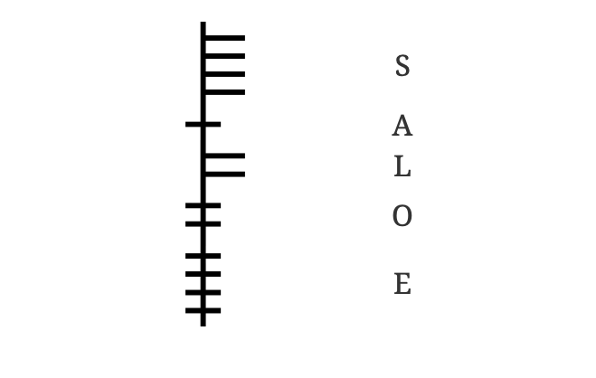

Ogham is an ancient alphabet that appeared in Ireland at least 1,600 years ago. It was used to inscribe [Primitive Irish](https://ogham.co/primitive-irish-language/) onto stone monuments. Ogham is written from bottom to top along a center line or "stem". Primitive Irish did not have several sounds that English has so, among the consonants, there is no letter for J (as in jam), K, V, W, Y, P, or the two distinct English sounds that are spelled with the TH digraph. Among the vowels, *many* substitutions are necessary as Primitive Irish had a very different vowel inventory than modern English. Visit [your name in Ogham](https://ogham.co/popular-ogham-names/) and the [Ogham transliterator](https://ogham.co/) to transliterate your own name into Ogham and see what substitutions it makes.

The word *ogham* refers only to the form of the letters, while the letters themselves are known collectively as the *Beith-luis-nin* , these are the first three names of the letters in the ogham alphabet, in the same manner as the word *alphabet* derives from the first two names of the letters *alpha* and *beta* .

### B Group – Right side strokes – *Aicme Beithe*

| Ogham | Letter | Name  | 
|-------|--------|-------|
| **ᚁ** | B      | beith |
| **ᚂ** | L      | luis  |
| **ᚃ** | V/F    | fearn |
| **ᚄ** | S      | sail  |
| **ᚅ** | N      | níon  | 

### H Group – Left side strokes – *Aicme hÚatha*

| Ogham | Letter | Name  |
|-------|--------|-------|
| **ᚆ** | H      | uath  |
| **ᚇ** | D      | dair  | 
| **ᚈ** | T      | tinne | 
| **ᚉ** | C      | coll  |
| **ᚊ** | K      | ceirt |

### M Group – Across strokes – *Aicme Muine*

| Ogham | Letter | Name    |
|-------|--------|---------|
| **ᚋ** | M      | muin    | 
| **ᚌ** | G      | gort    |
| **ᚍ** | NG     | nGéadal | 
| **ᚎ** | Z      | straif  | 
| **ᚏ** | R      | ruis    | 

### A Group – Notches (vowels) – *Aicme Ailme*

| Ogham | Letter | Name    | 
|-------|--------|---------|
| **ᚐ** | A      | ailm    |
| **ᚑ** | O      | onn     | 
| **ᚒ** | U      | úr      | 
| **ᚓ** | E      | eadhadh | 
| **ᚔ** | I      | iodhadh |

