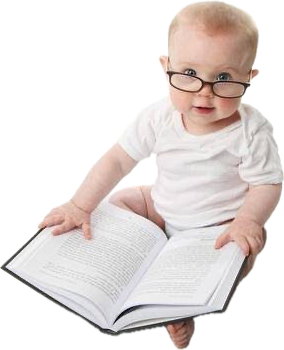
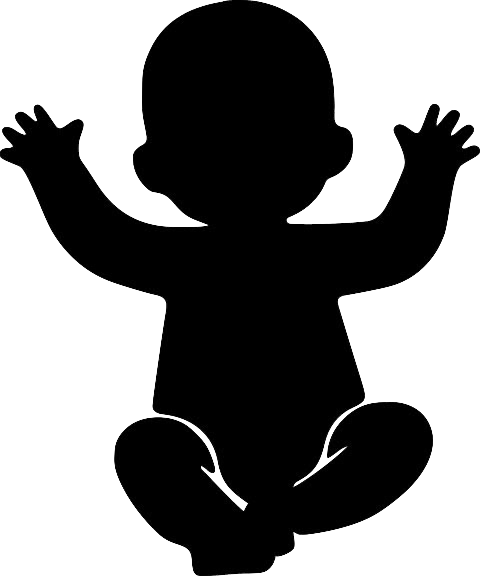

## Ling Link

::::: {.columns}

::: {.column width="50%"}

- what were your/a family member's first words?
- are there any words you and your family say uniquely because of how a child said them?  (e.g. *pasketti* 🍝)
- please discuss amongst yourselves for 3 minutes and post on this MS form:
- [https://forms.cloud.microsoft/r/UJLZzAbVGh](https://forms.cloud.microsoft/r/UJLZzAbVGh)

:::

::: {.column width="50%"}

{.absolute right="100" bottom="250" width="30%"}

:::

:::::

##


[MS Form Results](https://forms.cloud.microsoft/Pages/DesignPageV2.aspx?origin=NeoPortalPage&subpage=design&id=C1MwK7ZpV0S4GEgctT1CrmbPSVncwLtFk6IYqdcuVCVUQ1BTWVpIMUo2RlM5Uk5CWU1aNzlDMVVJWS4u&analysis=false&topview=Presentation)
  

## Observation 1: 

{.absolute bottom="0" right="0"}

::: {.r-fit-text .absolute top="250" .fragment .fade-up}

It **is** possible to learn a new language.

:::

:::: {.absolute top="200" left="300" .fragment}
⤹ ( but it's so hard, we hire AI owls to pester us)
::::

## It is possible to learn a new language, but...

1. For an adult, it requires a lot of effort and resources
2. takes a long time
3. the person will almost certainly always have a foreign accent in the language
4. the language itself is only a portion of what has to be learned; cultural norms and expectations, idioms, pragmatic meanings, rules of politeness, etc. all have to be learned to.

## Observation 2: 

{.absolute bottom="0" right="0"}

::: {.r-fit-text .absolute top="250" .fragment .fade-up}

Literal babies do this faster & better.

:::

## Babies learn to speak their language(s):

1. apparently effortlessly
2. quickly
3. with nearly full native fluency by the time they're 6
4. all while learning to do literally everything else a person has to know how to do!

##

::: {.r-fit-text .absolute top="250"}

How do kids learn to talk?

:::

{.absolute top="12" left="467" width="19%"}


## Acquiring a first language

::: {.fragment}

| Even very young children | |
|------|------|
|                            | make & hear their language's sounds |
|                            | say many words  |
|                            | make simple statements |

: {.lightbluebox tbl-colwidths="[50,50]"}

:::

::: {.fragment}

| By the age of six! |  |
|------|------|
|                            | master >= 90% of adult-like speech sounds |
|                            | master 80% of adult grammatical structures |

: {.mediumbluebox tbl-colwidths="[50,50]"}

:::


## Some Terminology

:::: {.incremental}

- **Language acquisition** is the process by which humans acquire the ability to use\, produce\, and perceive language\!
  * Involves the acquisition of all functional aspects of the system\, including phonetics, phonology, morphology, lexicon, syntax, and pragmatics
- **First** Language Acquisition: how an infant acquires his/her first or primary language
- **Second** Language Acquisition: how children and adults acquire additional languages beyond the first

::::

## Hypothesis #1: Purely Inductive

:::: {.chubby-margin}

```yaml { .animate src="images/inductive-deductive.svg" scale="2"}
setup:
  - element: "#Inductive"
    modifier: attr
    parameters:
      - class: fragment
        data-fragment-index: "0"
  - element: "#Inductive-label"
    modifier: attr
    parameters:
      - class: fragment
        data-fragment-index: "1"
  - element: "#Deductive"
    modifier: attr
    parameters:
      - class: fragment
        data-fragment-index: "2"
  - element: "#Deductive-label"
    modifier: attr
    parameters:
      - class: fragment
        data-fragment-index: "3"
```
::::

::: {.notes}

Early research suggested that language learning was a process of  __induction__

Children generalize linguistic patterns from the input they receive

inference of a generalized conclusion from particular instances; compare deduction

:::

## Induction

:::: {.incremental}

- Induction is probabilistic
  - There are always many logical possibilities to generalize
  - Children hear specific instances of sounds, morphemes, words, structures, from which they must derive the general principles of their language
  - Remember how hard it was to know where the words were when hearing a sentence?  How could a baby learn to find the words before they know any words?!?

::::

##

{.absolute left="300"}

## Induction (biases make things easier)

:::: {.columns}
::: {.column width="50%"}

- Induction in word learning
  - Humans have an inherent bias regarding meaning
  - We assume *Gavagai* means *rabbit* but it could mean "cute", "ears", "white", "mammal"
  - Infinite possibilities, but **whole object bias** suggests it will be the whole thing, not its parts
  
:::

::: {.column width="50%"}

{.r-stretch}
:::
::::

::::::: {.notes}

	Willard Van Orman Quine's thesis about the inscrutability of reference Word and Object (1960)

:::::::

## 

* But it’s not a simple case of imitation\!
  * "I goed to bed\."
  * "Me eat apples\."
  * "I brush my tooths\."
  * the Wug™ Test

##




## Hypothesis #2: Purely Deductive

:::: {.incremental}

- __The Innateness Hypothesis__
  * Language  _ability_  in humans is  **innate** \, or inborn
  * Humans are genetically predisposed to learn/use language
  * Babies are born with the knowledge that languages have patterns and with the ability to seek out those patterns
  * Requires reinforcement\, but no one “teaches” you how to talk
    * Children learn language as they live in it
    * But acquiring language is more than memorizing words and phrases
    * Grammatical and communicative competence

::::

# Turns out we need induction  _and _ deduction (innateness) to explain & understand language acquisition

## If it’s built in, why aren’t we born talking?!

:::: {.incremental}

* Physical **maturation**: speech is hard to do!!!
* Babies can use individual **sign language words** *months* before they can coordinate speech gestures
* __Symbolization__
  * Language = symbolic = arbitrary representation of the world (we do this very early)
  * To acquire language\, a child must be able to keep a mental model of other peoples' minds, ideas, expectations, beliefs (this takes longer)

::::

:::: {.incremental}
## Theory of Mind

  * **theory of mind** (ToM) emerges between 3 to 5 years of age
  * A child can't even try to lie until it has ToM
  * The ability to lie and the ability to understand how someone else are feeling derive from the same innate, human capacity for social understanding
  * Everyday activities like reading books, role play games, and family conversations about mental states (thoughts, feelings) measurably accelerate development

::::

## Adults help (even without knowing it)

::: {.r-fit-text .absolute top="250" .fragment .fade-up}

how do adults interact with babies to  _facilitate_  the language acquisition process?

:::

##

{.r-stretch}

## Parentese (aka Motherese)

- __Parentese__ is a register that adults use to talk *to* younger children
  - Exageratted **prosody**
  - Simplified sentences
- We used to think that not all cultures use Parentese
- Newer research suggests Parentese just looks very different from culture to culture
- But children learn language at same rate\!!

::: {.notes}

Exaggerated prosody helps children acquire phonology more easily
Simplified sentences help children acquire syntax more easily

:::


## Some Characteristics of Baby Talk

* There are several stages of language acquisition that we will explore:
  * Babbling
  * One\-Word Stage
  * Two\-Word Stage


# Stages of Language Acquisition


## Babbling

- Before about 10 months, interested in any speech sounds from any language
- Older than 10 months, start to only attend to sounds from the language their caregivers speak
- Less common sounds emerge later, 12 - 14 months


## One-Word Stage: 12 months

* Research suggests that children are doing more than just rehearsing single words
  * Children use single words to express whole propositions
  * A child may say “Dada” to mean different things in different contexts
* “Dada”

  - Here comes Daddy\!
  - This is for Daddy\.
  - That is where Daddy sits\.
  - This shoe is Daddy’s\.

## Two-Word Stage: Typically 1 ½ years

* The child has about 50 words in their vocabulary
* Utterances typically contain one noun\-like subject element and one predicate\-like element
  * Something like “John apple” is like…
  * _John_  	 _ate an apple_
  * subject       predicate

## Beyond two words?

{.r-stretch}

## Beyond two words?

* Here is a real parent\-child \(2;8\) interaction:
  * Child: I beed a princess\.
  * Mommy: You are the princess?
  * Child: No\, I  __beed__  a princess\.
* What happened?
  * Sounds Mommy heard: \[ajbidəprɪncɛs\]
    * Mommy’s interpretation = “I be \(am\) the princess”
    * Mommy questions child about utterance
  * Child’s actual meaning = “I beed \(was\) a princess”
    * Child has overgeneralized regular past tense


## What’s next?

- Monday: “How does bilingualism work?”
- Keep working on Observation Notes \#4
- Quiz 7 on Friday\!

