## Ling Link

- Last time I asked you what adult language learners might find difficult about learning English
- On the next slide there is a word cloud of (mostly) adjectives
- **please use at least 3 of these adjectives to describe an imaginary house**
- **describe at least two (2) different imaginary houses**
- then discuss your description with your neighbor(s)

## "House"

{width="1280" height="720"}
::: {.notes}

Quantity        How many?       
Opinion What is the general opinion?    
Size    How big or small?       
Age     How old?        
Shape   What shape?     
Color   What color?     
Origin  Where is it from?       
Material        What is it made of?     
Purpose What is it used for?

but it's really semantic and cultural; how central to this object does our culture believe this property to be

:::

##



## Things that are hard about English for Second Language Acquirers

::: {.incremental}

- **/θ/ and /ð/**: The two different sounds we spell with `th` are very rare in the world's languages and difficult to acquire 
- Listen to French accented-English, Chinese-accented English, German-accented English, Irish-accented English, etc.

:::

## Things (2)

- **Adjective order**:  Why is it okay to say "the tasty, round chocolate cookie" and not:

  - \*the round tasty chocolate cookie
  - \*the chocolate round tasty cookie
  - \*the round chocolate tasty cookie

## Things (3)

::: {.incremental}

- **The Definitie and Indefinite Articles**:

  - 'the' means something like "the world contains one of these things that is relevant to what I am saying" (e.g. the bicyle, the football team, the cookie)
  - 'a' and 'an' mean something like "I am talking about a thing that exists in the world, but it isn't relevant which one I mean" (e.g. a bicycle, a football team, a cookie)

- **Past Perfect vs. Present Perfect**: "I ate a cookie" vs "I have eaten a cookie"

- **Language-specific sound pairs**: /ɹ/ and /l/ for Japanese; /b/ and /v/ for Spanish speakers; /w/ and /v/ for Russian speakers, etc.

:::

## Bilingualism

We need to distinguish between two kinds of **bilingualism**.

- **Simultaneous Bilingualism**: occurs when a child grows up in a society where using more than one language is the norm.
- **Sequential Bilingualism**: occurs when an older child, teen, or adult acquires a second language

::: {.notes}

Multilingualism

:::

## Metalinguistic Awareness

::: {.incremental}

* Second\-language learners ordinarily have (or are capable of)  **metalinguistic awareness** that is lacking at least in the early stages of a first language
* __Metalinguistic awareness__  refers to the ability to  _consciously_  reflect on how language works
  * Helps in understanding the transfer of linguistic knowledge across languages \(e\.g\.\, code\-switching\, translation\)
  * Recognition that the potential exists to go beyond the literal meaning and that language offers flexibility  \(e\.g\.\, irony\, sarcasm\, word play\)
  * Understanding that language has a structure that can be manipulated \(we can talk about phonological\, word\, syntactic\, and pragmatic awareness\)

:::

{.r-stretch}

## Recall

* __Language acquisition __ is the process by which humans acquire the ability to use\, produce\, and perceive language\!
  * __First Language Acquisition: __ how an infant acquires his/her first or native language
  * __Second Language Acquisition: __ how children and adults acquire additional languages beyond the first
* How is FLA different than SLA?
* Multilingualism = global norm\!

## First vs Second Language Acquisition

::: {.incremental}

- First-language acquisition involves an initial linguistic experience, while a second language is mastered only by someone who already speaks another language
- A first language is usually acquired in a context-rich, home environment
- Because of age and social identity, the adaptability and flexibility of learners decreases for 2nd language learners

:::

## Acquiring a second language

* Remember\, a  __second language __ is any language that is acquired after one’s first language
  * It may well be a third or fourth “second” language
  * Many differences – environmental\, metalinguistic\, etc\.
* What are some of the issues associated with learning a second language later in life?
  * Helps in understanding why not everyone learns to speak “proper” English
  * And why you might have felt like you struggled with learning a language\!

{.r-stretch}

## A Second Language Acquiring Brain...

* If you read the short reading for today, you saw:
  * Learning a new language = a cognitive workout\!
  * Our brains are flexible\!
* They talked about multiple languages being at different “volumes”
  * How “loud” a language is = connected to age\, how often you use it\, how proficient you are
  * It’s harder to lower the volume on some languages \(e\.g\.\, the ones you use most\)
  * The switching costs depend on how similar the languages are
* All of this contributes to how well we acquire additional languages

## Interlanguage

* Some researchers view second\-language learners as developing a series of *interlanguages* in their progression towards mastery of the target language
  * An  __interlanguage__  is the set of forms of the target language that a learner has internalized\, some of which may be native\-like while many may not\, but may still develop toward the native norm
  
## Fossilization

* A big problem in learning a second language is  __fossilization__
  * The process by which second language learners develop a linguistic system that is different from both the learner's first language and the target language
  * Looks like a plateau or loss of progress
  * In most adults\, the language\-learning process typically slows down or ceases at some point\, for various reasons such as age\, motivation\, communicative needs, and social flexibility

## Critical Period

* It’s possible fossilization is connected to this idea of a  __critical period __
  * The hypothesis is that\, as we age\, learning a second language becomes more difficult
  * It is more ideal to acquire language in childhood\, in those context\-rich environments
  * This ideal time is usually thought to be before and around the start of puberty\, but it differs from person to person
  * The evidence in favor of a critical period has been centered on the study of second language accents

:::{.notes}

ASK: we often don't even start second language learning until 9th grade.  Does that make sense?

:::

##

* In addition to the things we’ve already said about language \(e\.g\.\, rule\-governed\, systematic\, communicative\, arbitrary\)\, we can also say that:
  * __All languages are equally challenging__
    * …or equally easy
    * Every child who is capable of acquiring language  __will acquire__  a language
* There is no biological basis that predisposes children to learn any PARTICULAR language
  * This is usually determined by the language\(s\)/culture\(s\) children grow up in
  * However\, acquiring certain features of certain languages  _may_  require more time to acquire
    * Ex\. German vs\. English definite articles

## Why some languages seem harder than others

- Plenty of people will say Latin/Arabic/Chinese “is soooooo hard”
- What they really mean = “It is soooooo hard for me compared to my native language”
- No such thing as “primitive” languages; all languages have  __linguistic complexity__
- Simplicity in one area > relative complexity in another

## The role of motivation

* Many of you are here because you decided that you don’t like learning languages\, or you feel like you aren’t “good” at them
* Perhaps you also lack the motivation to learn one
  * “When would I ever use French in real life?”
  * “English is spoken everywhere now\!”
* What types of motivations can we find?
  * __Instrumental motivation:__  one in which knowledge of the target language will help achieve some other goal
    * Singing opera\, conducting business\, etc\.
  * __Integrative motivation: __ need to learn to fully integrate into a community that uses the language
    * I want to live there\!

# Enjoy Break!