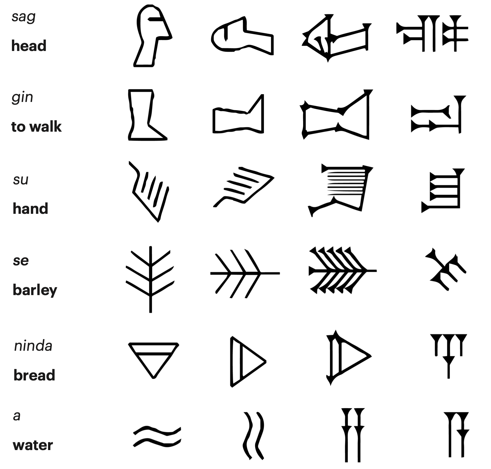
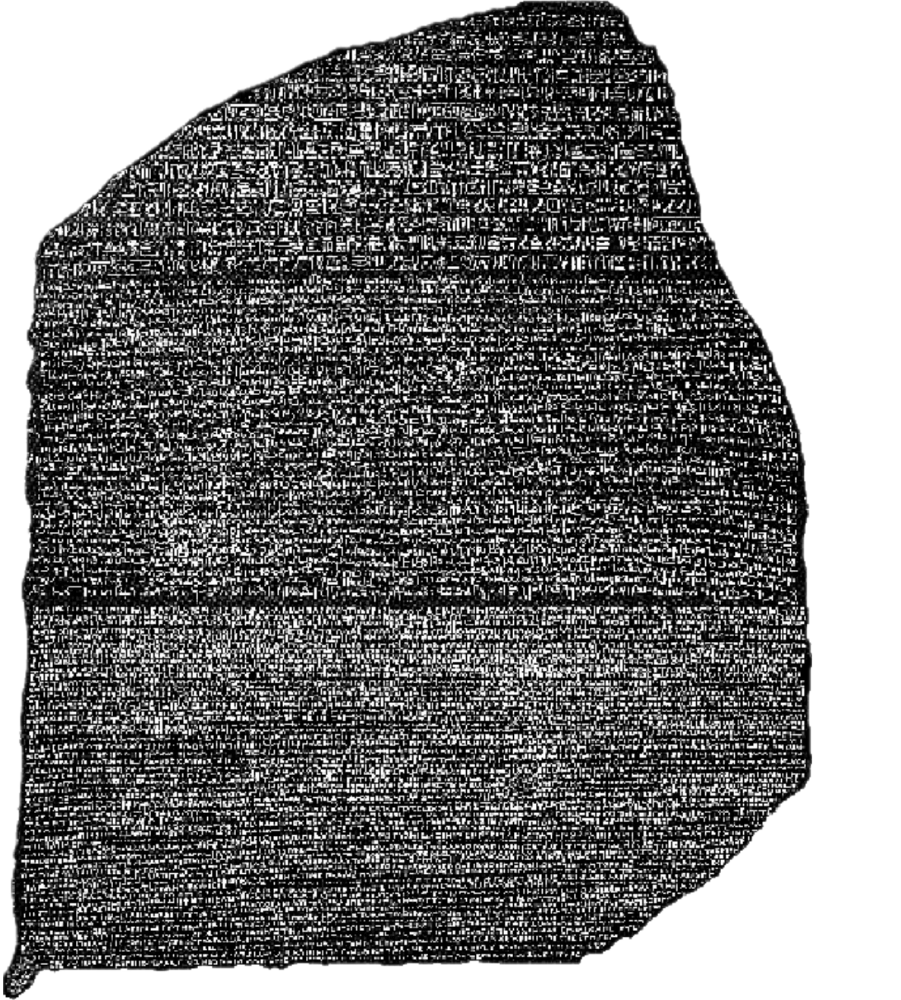
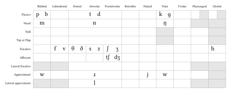
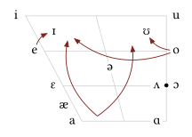

# How is writing different from speaking?

# Language in the World

---
## Language existed before writing

- Our species is about 6 million years old
- Humans communicated through language long before the invention of writing
- Writing is only a few thousand years old

## How many times was writing invented?

Writing has been invented at least three separate times:

1. Mesopotamia — Cuneiform (~5,000 years ago)
2. China — early Chinese (~3,500 years ago)
3. Mesoamerica — Mayan (~3,000 years ago)

::: notes
Explain that independent invention means the development of a genuine system for recording language without deriving it from an already existing writing system. Egypt's relationship to Mesopotamian influence is debated. Some accounts also distinguish the earliest Mesoamerican scripts from the later, well-documented Maya script.
:::

## Surviving evidence of the first writing systems

| Region | Approximate early evidence | Example |
|---|---|---|
| Mesopotamia | Around 3400–3200 BCE | Cuneiform |
| Egypt | Around 3300–3000 BCE | Hieroglyphs |
| China | Around 1250 BCE | Oracle-bone inscriptions |
| Mesoamerica | First millennium BCE | Maya |

::: notes
The dates in this table refer to surviving evidence, not necessarily the exact moment of invention. Chinese oracle-bone inscriptions already show a developed writing system, implying earlier development that has not been fully documented.
:::

## Writing is a technology that is usually borrowed

## Cuneiform: writing with wedges

::: {.r-fit-text}
𒀀 𒂗
:::

- **Pictograms** evolved into **logograms** representing ideas and **phonograms** representing whole syllables (a syllabary)
- Signs were impressed into clay with a reed stylus.
- The name *cuneiform* refers to its wedge-shaped marks (from Latin _cuneo_)
- Eventually used to write several languages, including: Sumerian, Akkadian, Babylonian, Elamite, Hatti, Hittite, Assyrian, and Hurrian

::: notes
these symbols are water and lord
Cuneiform is a script, not a language. Sumerian and Akkadian were distinct languages that could be recorded using cuneiform conventions. Its signs could represent words, syllables, and other linguistic information.
:::

##

{.r-stretch}

## Egyptian hieroglyphs

::: {.r-fit-text}
𓂀 𓋹 𓊹
:::

- Hieroglyphs appear on papyrus, monuments, objects, and tombs
- **Important:** Hieroglyphs are _not_ simply pictures, they could be used three ways:
- **Pictographic**: Early forms evolved into
- **Logographic**: Signs representing words or concepts and
- **Phonographic**: Signs representing consonants (an abjad similar to modern Hebrew or Arabic)

::: notes
Explain that some signs are pictorial in appearance, but their function in a text depends on convention. A picture of an animal might represent the animal, a sound associated with its name, or a component of a longer word.
:::

##

:::::: {.columns}
:::: {.column width="50%"}
{width="100%"}
::::

:::: {.column width="50%"}

- We can read Egyption hieroglyphics today thanks to _multilingualism_
- The Rosetta Stone contains three nearly identical translations of a royal decree from 196 BC
- The top text is Ancient Egyption Hieroglyphs, the middle is Demotic script (a later phonographic Egyptian script), and the bottom is Ancient Greek

::::
::::::

## LING LINK

- **Discussion Question**: What kind of writing system does written English use? Pictographic, Logographic, or Phonographic
- Think about easy words like: big, sap, help, go
- But also harder words like: phlegm, eightth, psychology, judge, gym

## English writing is phonographic

- We have symbols (borrowed from Latin, which also borrowed them) that more or less correspond to our consonant and vowel sounds
- How many sounds are there in a word like feather?

::: {.r-fit-text}
FEATHER
:::

## Consonant Sounds

- B C D F G H J K L M N P Q R S T V W X Y Z are _not_ consonants. They are consonant symbols.
- The 25 American English consonant sounds are:

## Vowel Sounds vs Vowel Symbols

- A E I O and U are _not_ vowels.  They are vowel symbols
- The ~17 American English vowels are:

## Chinese characters

::: {.r-fit-text}
爱 禧 猫
:::

Chinese writing uses characters that generally correspond to meaningful linguistic units, often morphemes, and have conventional pronunciations.

- Evolved from pictographic representations to logographs
- The only one of the 3 or 4 independently-invented writing systems that has remained in continuous use!
- Adopted by many cultures to write numerous languages including Japanese, Korean, and Vietnamese
- The same character may be pronounced differently in different contexts or varieties.

::: {.notes}
爱 Ài love
禧 Xǐ joy
猫 Māo cat
:::

## Maya writing: words and syllables

Maya hieroglyphs combined signs representing words with signs representing syllables.

- Used by Maya communities in Mesoamerica.
- Recorded names, dates, political events, and ritual information.
- Appeared on monuments, ceramics, and books.
- Much of the surviving script can now be read, though some signs and passages remain uncertain.

Maya writing encoded spoken languages; it was not simply a set of pictures.

::: notes
The script was used to record languages in the Mayan language family. Decipherment advanced substantially during the twentieth century. Emphasize the continued cultural significance of Maya writing and the work of Indigenous scholars and communities.
:::

## 

**One language can use multiple scripts, and one script can be used for multiple languages.**

- Latin script: English, Turkish, Vietnamese
- Cyrillic script: Russian, Bulgarian, Tajik (a Persian language)
- Arabic-derived scripts: Arabic, Urdu, Farsi (a Persian language)
- Cuneiform: Sumerian, Akkadian, old Farsi (a Persian language)
- Chinese characters: Chinese and historically Japanese, Korean, Vietnamese, Zhuang

::: notes
Mention that writing conventions are adapted to the sound systems and structures of individual languages. Sharing a script does not mean two languages are closely related or mutually intelligible.
:::

## Emoji?

::: {.r-fit-text}

😭 👀 💀

:::

- You tell me, are Emojis pictographic, logographic, or phonographic?
- Or maybe they do something else entirely when you use them?
- Discuss amongst yourselves
- Think about: generational differences, individual differences, regional/social differences(?)

## Take aways

::: {style="font-size: 1.15em;"}
**Language is not writing.**
:::

- Language is a feature of being human
- Writing is a technology for representing linguistic information
- Writing systems differ in how they represent words, syllables, and sounds
- Writing emerged independently in a small number of places and spread or developed like any technology

::: notes
Return to the opening question. Ask students to explain the distinction in their own words and to give one example of a language-script relationship that surprised them.
:::

## Arabic: an abjad

::: {.r-fit-text}
العربية
:::

Arabic script is written from right to left.

- Letters primarily represent consonants (like Egyptian)
- Short vowels are typically omitted in ordinary writing
- Diacritics can mark vowels and other details when needed.
- Letter shapes change depending on their position in a word.

Arabic is a language; Arabic script is a writing system that is also used for other languages

::: notes
An abjad is a writing system in which consonants are primary and vowels may be represented incompletely or optionally. Arabic is not the only language written in Arabic-derived scripts; Persian, Urdu, and others use related adaptations.
:::

## Russian: the Cyrillic alphabet

::: {.r-fit-text}
Привет! Это русский язык.
:::

Russian uses a version of the Cyrillic alphabet.

- Phonographic: Letters represent speech sounds.
- Some letters represent more than one sound or influence neighboring sounds.
- Spelling does not always correspond perfectly to pronunciation.

Cyrillic is a script, not a language.

It is also used by many other languages, including Bulgarian and Serbian, with differences between their alphabets.

::: notes
Ask students to compare the appearance of Russian Cyrillic with the Latin alphabet. Some letters resemble Latin letters but represent different sounds. The script's history is connected to Greek writing traditions.
:::

## Korean: Hangul

::: {.r-fit-text}
한글
:::

Hangul is the writing system used for Korean.

- Developed in 1444 - 1446 under King Sejong the Great (r. 1418–1450)
- Its letters represent consonants and vowels.
- Letters are arranged into syllable blocks.
- Syllable blocks are not equivalent to Chinese characters

Korean is the language; Hangul is its writing system.

::: notes
Hangul was created under King Sejong and introduced in the fifteenth century. It is often described as a featural alphabet because certain letter shapes systematically reflect phonetic properties. Its syllable blocks are not equivalent to Chinese characters.
:::