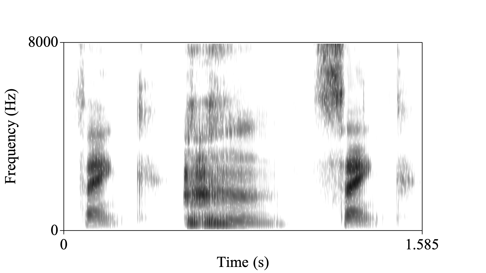
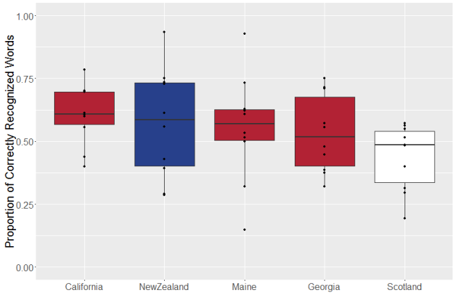

<!--
```{r echo=FALSE, include=FALSE}
#| label: load

install.packages("phonTools")
install.packages("audio")

library(phonTools)
library(audio)

# create a command to insert html audio with auto-play disabled
html_audio <- function(file, type = "wav") {
  htmltools::tags$audio(controls = NA,
  htmltools::tags$source(src = file,
  type = glue::glue("audio/{type}",
  type = type)))
}
```
-->

## Ling Link

- We’re going to watch a video (with CC on!) to see how well Siri can do with the Southern accent!
- Your job is to note which **specific** linguistic features Siri struggles with
- These might be lexical, phonetic, or syntactic
- (While you’re at it, since CC is turned on, you can also see how well Google does with its automatic transcription of what the individuals are saying about their interactions with Siri!)

[https://www\.youtube\.com/watch?v=MuWL1J2s2tY](https://www.youtube.com/watch?v=MuWL1J2s2tY)

---




## Computational linguistics

__Computational linguistics __ can be either:

1. Programming/training computers to complete linguistic tasks, or
2. Using computational methods to conduct linguistics research

:::: {.fragment}
* Linguistic tasks include things like:
  * Speech synthesis (especially Text To Speech or TTS)
  * Automatic Speech Recognition
  * Machine translation
  * (Large) Language modeling
::::

## Speech recognition and synthesis

* Your devices rely on  __speech recognition technologies__ \, which means that they have the ability to:
  - recognize and translate human spoken language into text that can be understood by computers
  - and convert text into patterns of sound that people can make sense of
  
* This allows you to use commands like "call Mom" or "should I wear a sweater today?"
  - actually, let's try that one!
  - anyone with an android phone willing to come up here?

## Text To Speech (TTS)

- Articulatory synthesis
- Waveform synthesis (e.g. Stephen Hawking's voice)
- Diphone concatenative synthesis
- Unit selection concatenative synthesis
- HMM synthesis (aka Statistical Parametric Synthesis)

::: {.notes}

HMM-based synthesis is a synthesis method based on hidden Markov models, also called Statistical Parametric Synthesis. In this system, the frequency spectrum (vocal tract), fundamental frequency (voice source), and duration (prosody) of speech are modeled simultaneously by HMMs. Speech waveforms are generated from HMMs themselves based on the maximum likelihood criterion

:::

## Articulatory Synthesis

[Pink Trombone (caution: cursed)](https://dood.al/pinktrombone/)

# Let's look at some of the other TTS technologies


## Automatic Speech Recognition

- Automatic Speech Recognition (ASR) goes the other way!
- A microphone captures speech vibrations
- A computer converts these into a digital representation of the frequencies
- Features of these frequencies are extracted every few milliseconds (MFCCs)

<!--## ASR Challenges

```{r echo=FALSE}
#| label: S1
hear <- load.wave("recordings/susan-chain.wav")

spectrogram(hear, color=FALSE, quality=TRUE, maxfreq=8000, dynamicrange=70)
```

::: aside
`r html_audio("recordings/susan-chain.wav")`
:::
-->

## ASR Challenges

{.r-stretch}

## Performance

::: {.incremental}

* Speech recognition is complex
  * Background noise can get in the way
  * Foreground noise can get in the way!
  * Linguistic variation can be tricky to capture [@martin2023bias, @koenecke2020racial, @mengesha2021don]
  * Especially when the ASR researchers _themselves_ are biased [@feng2021quantifying]
* I said they were getting better – how do we know?
  * __Accuracy__  – how often does the system get it wrong?
  * __Speed__  – how quickly does it convert from speech to text?

:::


## Issues faced in accuracy

::: {.notes}

- Have you ever had trouble with Siri understanding what you’ve said?
- Some of the accuracy issues may have been part of the problem, but often, linguistic variation in accent, word choice, etc. can be the problem
- African Americans experience error rates up to two times higher than other speakers of American English [@koenecke2020racial] 

:::

## Linguistic variation

* Has Siri had trouble understanding what you’ve said?
* Some of the accuracy issues may have been part of the problem\, but often\, linguistic variation in accent\, word choice\, etc\. can be the problem
* Research has shown that
  * African Americans experience error rates up to two times higher than other speakers of American English
    * Word identification is less accurate\, but
    * Word prediction is sometimes better compared to majority dialects

##

{.r-stretch}

* Proportion of correctly recognized words by dialect area\, color coded by country
  * Used YouTube auto\-captions on Accent Tag videos \(powered by Google\)
  * Works best on people from California \(which just happens to be where Google is headquartered\)
  * Works worst on Scottish English
  
::: {.notes}

https://makingnoiseandhearingthings.com/2016/07/11/which-accents-does-automatic-speech-recognition-work-best-for/ 

:::


## References
