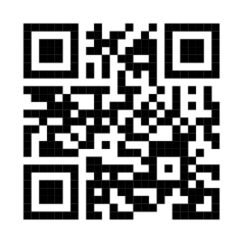
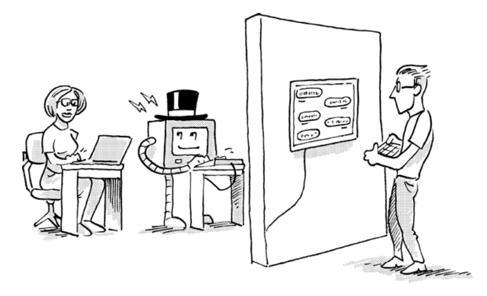
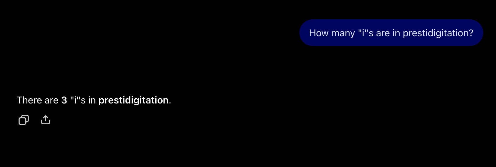
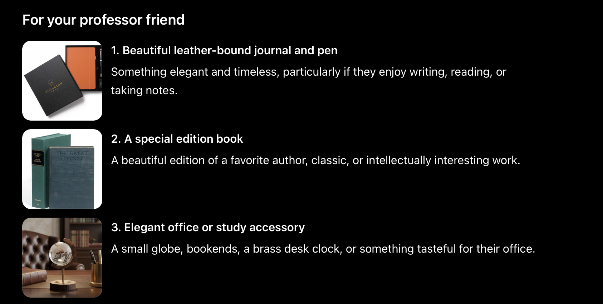

## Ling Link

:::::: {.columns}

:::: {.column width="40%"}

{width="100%"}
[https://eliza.dotink.co/](https://eliza.dotink.co/)

::::

:::: {.column width="60%"}

- Please try out this chatbot (ELIZA) written in 1965 [@weizenbaum1966eliza]
- Talk to it, tell it your problem, answer its questions
- Can you tell what it's doing?
- Do you find it at all convincing?
- Discuss with your neighbors

::::


::::::

## What is a chatbot?

::: {.incremental}

- Chatbots are computer programs that are designed to have conversations with users
- Older models (like ELIZA) were also part of AI research, new programs are just much more sophisticated
- Most chatbots today are based on Large Language Models (LLMs), in which an artificial neural network is trained on vast quantities of text
- Here's a particularly dumb chatbot I wrote in 1994: [the chomskybot](http://www.chomskybot.com/cgi-bin/chomsky.pl)
:::

## Eliza's Rogerian Script

```
initial: How do you do.  Please tell me your problem.
final: Goodbye.  Thank you for talking to me.
quit: bye
quit: goodbye
quit: quit
pre: dont don't
pre: cant can't
pre: wont won't
pre: recollect remember
pre: dreamt dreamed
pre: dreams dream
pre: maybe perhaps
pre: how what
pre: when what
pre: certainly yes
pre: machine computer
pre: computers computer
pre: were was
pre: you're you are
pre: i'm i am
pre: same alike
post: am are
post: your my
post: me you
post: myself yourself
post: yourself myself
post: i you
post: you I
post: my your
post: i'm you are
synon: belief feel think believe wish
synon: family mother mom father dad sister brother wife children child
synon: desire want need
synon: sad unhappy depressed sick
synon: happy elated glad better
synon: cannot can't
synon: everyone everybody nobody noone
synon: be am is are was
key: xnone
  decomp: *
    reasmb: I'm not sure I understand you fully.
    reasmb: Please go on.
    reasmb: What does that suggest to you ?
    reasmb: Do you feel strongly about discussing such things ?
key: sorry
  decomp: *
    reasmb: Please don't apologise.
    reasmb: Apologies are not necessary.
    reasmb: I've told you that apologies are not required.
key: apologise
  decomp: *
    reasmb: goto sorry
key: remember 5
  decomp: * i remember *
    reasmb: Do you often think of (2) ?
    reasmb: Does thinking of (2) bring anything else to mind ?
    reasmb: What else do you recollect ?
    reasmb: Why do you recollect (2) just now ?
    reasmb: What in the present situation reminds you of (2) ?
    reasmb: What is the connection between me and (2) ?
  decomp: * do you remember *
    reasmb: Did you think I would forget (2) ?
    reasmb: Why do you think I should recall (2) now ?
    reasmb: What about (2) ?
    reasmb: goto what
    reasmb: You mentioned (2) ?
key: if 3
  decomp: * if *
    reasmb: Do you think its likely that (2) ?
    reasmb: Do you wish that (2) ?
    reasmb: What do you know about (2) ?
    reasmb: Really, if (2) ?
key: dreamed 4
  decomp: * i dreamed *
    reasmb: Really, (2) ?
    reasmb: Have you ever fantasized (2) while you were awake ?
    reasmb: Have you ever dreamed (2) before ?
    reasmb: goto dream
key: dream 3
  decomp: *
    reasmb: What does that dream suggest to you ?
    reasmb: Do you dream often ?
    reasmb: What persons appear in your dreams ?
    reasmb: Do you believe that dreams have something to do with your problems ?
key: perhaps
  decomp: *
    reasmb: You don't seem quite certain.
    reasmb: Why the uncertain tone ?
    reasmb: Can't you be more positive ?
    reasmb: You aren't sure ?
    reasmb: Don't you know ?
key: name 15
  decomp: *
    reasmb: I am not interested in names.
    reasmb: I've told you before, I don't care about names -- please continue.
key: deutsch
  decomp: *
    reasmb: goto xforeign
    reasmb: I told you before, I don't understand German.
key: francais
  decomp: *
    reasmb: goto xforeign
    reasmb: I told you before, I don't understand French.
key: italiano
  decomp: *
    reasmb: goto xforeign
    reasmb: I told you before, I don't understand Italian.
key: espanol
  decomp: *
    reasmb: goto xforeign
    reasmb: I told you before, I don't understand Spanish.
key: xforeign
  decomp: *
    reasmb: I speak only English.
key: hello
  decomp: *
    reasmb: How do you do.  Please state your problem.
    reasmb: Hi.  What seems to be your problem ?
key: computer 50
  decomp: *
    reasmb: Do computers worry you ?
    reasmb: Why do you mention computers ?
    reasmb: What do you think machines have to do with your problem ?
    reasmb: Don't you think computers can help people ?
    reasmb: What about machines worrys you ?
    reasmb: What do you think about machines ?
key: am
  decomp: * am i *
    reasmb: Do you believe you are (2) ?
    reasmb: Would you want to be (2) ?
    reasmb: Do you wish I would tell you you are (2) ?
    reasmb: What would it mean if you were (2) ?
    reasmb: goto what
  decomp: *
    reasmb: Why do you say 'am' ?
    reasmb: I don't understand that.
key: are
  decomp: * are you *
    reasmb: Why are you interested in whether I am (2) or not ?
    reasmb: Would you prefer if I weren't (2) ?
    reasmb: Perhaps I am (2) in your fantasies.
    reasmb: Do you sometimes think I am (2) ?
    reasmb: goto what
  decomp: * are *
    reasmb: Did you think they might not be (2) ?
    reasmb: Would you like it if they were not (2) ?
    reasmb: What if they were not (2) ?
    reasmb: Possibly they are (2) .
key: your
  decomp: * your *
    reasmb: Why are you concerned over my (2) ?
    reasmb: What about your own (2) ?
    reasmb: Are you worried about someone else's (2) ?
    reasmb: Really, my (2) ?
key: was 2
  decomp: * was i *
    reasmb: What if you were (2) ?
    reasmb: Do you think you were (2) ?
    reasmb: Were you (2) ?
    reasmb: What would it mean if you were (2) ?
    reasmb: What does (2) suggest to you ?
    reasmb: goto what
  decomp: * i was *
    reasmb: Were you really ?
    reasmb: Why do you tell me you were (2) now ?
    reasmb: Perhaps I already know you were (2) .
  decomp: * was you *
    reasmb: Would you like to believe I was (2) ?
    reasmb: What suggests that I was (2) ?
    reasmb: What do you think ?
    reasmb: Perhaps I was (2) .
    reasmb: What if I had been (2) ?
key: i
  decomp: * i @desire *
    reasmb: What would it mean to you if you got (3) ?
    reasmb: Why do you want (3) ?
    reasmb: Suppose you got (3) soon ?
    reasmb: What if you never got (3) ?
    reasmb: What would getting (3) mean to you ?
    reasmb: What does wanting (3) have to do with this discussion ?
  decomp: * i am * @sad *
    reasmb: I am sorry to hear that you are (3) .
    reasmb: Do you think that coming here will help you not to be (3) ?
    reasmb: I'm sure it's not pleasant to be (3) .
    reasmb: Can you explain what made you (3) ?
  decomp: * i am * @happy *
    reasmb: How have I helped you to be (3) ?
    reasmb: Has your treatment made you (3) ?
    reasmb: What makes you (3) just now ?
    reasmb: Can you explan why you are suddenly (3) ?
  decomp: * i was *
    reasmb: goto was
  decomp: * i @belief * i *
    reasmb: Do you really think so ?
    reasmb: But you are not sure you (3) .
    reasmb: Do you really doubt you (3) ?
  decomp: * i * @belief * you *
    reasmb: goto you
  decomp: * i am *
    reasmb: Is it because you are (2) that you came to me ?
    reasmb: How long have you been (2) ?
    reasmb: Do you believe it is normal to be (2) ?
    reasmb: Do you enjoy being (2) ?
  decomp: * i @cannot *
    reasmb: How do you think that you can't (3) ?
    reasmb: Have you tried ?
    reasmb: Perhaps you could (3) now.
    reasmb: Do you really want to be able to (3) ?
  decomp: * i don't *
    reasmb: Don't you really (2) ?
    reasmb: Why don't you (2) ?
    reasmb: Do you wish to be able to (2) ?
    reasmb: Does that trouble you ?
  decomp: * do i feel *
    reasmb: Tell me more about such feelings.
    reasmb: Do you often feel (2) ?
    reasmb: Do you enjoy feeling (2) ?
    reasmb: Of what does feeling (2) remind you ?
  decomp: * i * you *
    reasmb: Perhaps in your fantasies we (2) each other.
    reasmb: Do you wish to (2) me ?
    reasmb: You seem to need to (2) me.
    reasmb: Do you (2) anyone else ?
  decomp: *
    reasmb: You say (1) ?
    reasmb: Can you elaborate on that ?
    reasmb: Do you say (1) for some special reason ?
    reasmb: That's quite interesting.
key: you
  decomp: * you remind me of *
    reasmb: goto alike
  decomp: * you are *
    reasmb: What makes you think I am (2) ?
    reasmb: Does it please you to believe I am (2) ?
    reasmb: Do you sometimes wish you were (2) ?
    reasmb: Perhaps you would like to be (2) .
  decomp: * you * me *
    reasmb: Why do you think I (2) you ?
    reasmb: You like to think I (2) you -- don't you ?
    reasmb: What makes you think I (2) you ?
    reasmb: Really, I (2) you ?
    reasmb: Do you wish to believe I (2) you ?
    reasmb: Suppose I did (2) you -- what would that mean ?
    reasmb: Does someone else believe I (2) you ?
  decomp: * you *
    reasmb: We were discussing you -- not me.
    reasmb: Oh, I (2) ?
    reasmb: You're not really talking about me -- are you ?
    reasmb: What are your feelings now ?
key: yes
  decomp: *
    reasmb: You seem to be quite positive.
    reasmb: You are sure.
    reasmb: I see.
    reasmb: I understand.
key: no
  decomp: *
    reasmb: Are you saying no just to be negative?
    reasmb: You are being a bit negative.
    reasmb: Why not ?
    reasmb: Why 'no' ?
key: my 2
  decomp: $ * my *
    reasmb: Lets discuss further why your (2) .
    reasmb: Earlier you said your (2) .
    reasmb: But your (2) .
    reasmb: Does that have anything to do with the fact that your (2) ?
  decomp: * my * @family *
    reasmb: Tell me more about your family.
    reasmb: Who else in your family (4) ?
    reasmb: Your (3) ?
    reasmb: What else comes to mind when you think of your (3) ?
  decomp: * my *
    reasmb: Your (2) ?
    reasmb: Why do you say your (2) ?
    reasmb: Does that suggest anything else which belongs to you ?
    reasmb: Is it important that your (2) ?
key: can
  decomp: * can you *
    reasmb: You believe I can (2) don't you ?
    reasmb: goto what
    reasmb: You want me to be able to (2) .
    reasmb: Perhaps you would like to be able to (2) yourself.
  decomp: * can i *
    reasmb: Whether or not you can (2) depends on you more than me.
    reasmb: Do you want to be able to (2) ?
    reasmb: Perhaps you don't want to (2) .
    reasmb: goto what
key: what
  decomp: *
    reasmb: Why do you ask ?
    reasmb: Does that question interest you ?
    reasmb: What is it you really wanted to know ?
    reasmb: Are such questions much on your mind ?
    reasmb: What answer would please you most ?
    reasmb: What do you think ?
    reasmb: What comes to mind when you ask that ?
    reasmb: Have you asked such questions before ?
    reasmb: Have you asked anyone else ?
key: because
  decomp: *
    reasmb: Is that the real reason ?
    reasmb: Don't any other reasons come to mind ?
    reasmb: Does that reason seem to explain anything else ?
    reasmb: What other reasons might there be ?
key: why
  decomp: * why don't you *
    reasmb: Do you believe I don't (2) ?
    reasmb: Perhaps I will (2) in good time.
    reasmb: Should you (2) yourself ?
    reasmb: You want me to (2) ?
    reasmb: goto what
  decomp: * why can't i *
    reasmb: Do you think you should be able to (2) ?
    reasmb: Do you want to be able to (2) ?
    reasmb: Do you believe this will help you to (2) ?
    reasmb: Have you any idea why you can't (2) ?
    reasmb: goto what
  decomp: *
    reasmb: goto what
key: everyone 2
  decomp: * @everyone *
    reasmb: Realy, (2) ?
    reasmb: Surely not (2) .
    reasmb: Can you think of anyone in particular ?
    reasmb: Who, for example?
    reasmb: Are you thinking of a very special person ?
    reasmb: Who, may I ask ?
    reasmb: Someone special perhaps ?
    reasmb: You have a particular person in mind, don't you ?
    reasmb: Who do you think you're talking about ?
key: everybody 2
  decomp: *
    reasmb: goto everyone
key: nobody 2
  decomp: *
    reasmb: goto everyone
key: noone 2
  decomp: *
    reasmb: goto everyone
key: always 1
  decomp: *
    reasmb: Can you think of a specific example ?
    reasmb: When ?
    reasmb: What incident are you thinking of ?
    reasmb: Really, always ?
key: alike 10
  decomp: *
    reasmb: In what way ?
    reasmb: What resemblence do you see ?
    reasmb: What does that similarity suggest to you ?
    reasmb: What other connections do you see ?
    reasmb: What do you suppose that resemblence means ?
    reasmb: What is the connection, do you suppose ?
    reasmb: Could here really be some connection ?
    reasmb: How ?
key: like 10
  decomp: * @be * like *
    reasmb: goto alike
```

## Eliza {background-iframe="https://eliza.dotink.co/"}

# Can machines think?

{width="100%"}

::: {.absolute right="0" top="250" .fragment}
(and, also?

how could we know?)
:::

## The Turing Test

::: {.incremental}

- Alan Turing [@TURING1950] proposed an "Imitation Game" to sidestep this question
- Because behaviorists, like Turing was at the time, believed thinking and consciousness could not be observed, Turing proposed an alternative:
- "replace the question by another, _which is closely related to it_ and is expressed in relatively unambiguous words" (emphasis mine)
- Can a digital computer be created which can fool an Interrogator into believing it is human?

:::

## The Turing Test

{.r-stretch}

## The Turing Test is not how language works

::: {.incremental}

- Unfortunately, although he was an amazing computer scientist and cryptographer, Turing didn't know anything about Language or Linguistics
- The problem is that we humans are _terrible_ at being this Interrogator **because** of the way language works
- There is no meaning in this text until you, as the Interrogator, create it.
- Eliza's author, Joseph Weizenbaum, observed that, "Some subjects have been very hard to convince that
ELIZA (with its present script) is *not* human." Further, he wrote:

:::

##

> "If, for example, one were to tell a psychiatrist, "I went for a long boat ride" and he responded "Tell me about boats", one would not assume that he knew nothing about boats, but that he had some purpose in so directing the subsequent conversation. It is important to note that this assumption is one made by the speaker.
Whether it is realistic or not is an altogether separate question. In any case, it has a crucial psychological utility in that it serves the speaker to maintain his sense of being heard and understood.  The speaker further defends his impression (which even in real life may be illusory) by attributing to his conversational partner all sorts of background knowledge, insights and reasoning ability. But again, these are the *speaker's* contribution to the conversation.  They manifest themselves inferentially in the *interpretations* he makes of the offered responses. ... The human speaker will, as has been said, contribute much to clothe ELIZA'S responses in vestments of plausibility." [@weizenbaum1966eliza, p. 42]


## Where does meaning come from?

:::::: {.columns}

::: {.column width="40%"}

{width="100%"}

:::

::: {.column width="60%"}

- All meaning is subjectively experienced
- Language is often not for the communication of facts
- but the communication of intention, identity, relationship
- Computers, cannot have intentions, identities, or relationships
  
:::
::::::

## Where does meaning come from?

:::::: {.columns}

::: {.column width="60%"}

* We humans are predisposed to create meaning in language and in text\!\!
* We engage with machines AS IF the machine were producing meaningful utterances \(like humans do\)
* Making chatbots deceptive “[counterfeit people](https://www.citizen.org/article/chatbots-are-not-people-dangerous-human-like-anthropomorphic-ai-report/)”
  
:::

::: {.column width="40%"}

{width="100%"}

:::

::::::

::: {.notes}

counterfeit humans who deceive us (whether that was the programmer's intention or not) into believing they are real\!

:::

---

##

{.r-stretch .absolute left="175}

## Stochastic Parrots

* Emily Bender and colleagues describe LLMs as “stochastic parrots” [@bender2021dangers]
  * __Stochastic __ means something is randomly determined or has a random probability distribution
  * “for haphazardly stitching together sequences of linguistic forms … according to probabilistic information about how they combine\, but without any reference to meaning\.” \(Bender\)
  * The expression means generative AI, like parrots\, cannot understand what they have produce
* "You can’t expect a machine\-learning system to learn stuff that’s not in it’s training data…otherwise you’re expecting magic\."


{.r-stretch}

##

{.r-stretch .absolute left="50"}

::: {.notes}

Other image from here: https://www.webfx.com/blog/marketing/chatgpt-fails/

:::

##

{.r-stretch .absolute left="50"}

# Me: My friends, a professor and a nurse, are getting married and I want to get each of them something nice. What are some appropriate gifts?

##

{.r-stretch .absolute left="50"}

##

{.r-stretch .absolute left="50"}

## Did you know?

* LLMs are
  * Not being engineered to use energy or water efficiently?
  * The reason computer memory and storage and electricity are so expensive right now?
  * Expensive to create, and are trained on unlicenses, sometimes private, data?
  * Overconfident on relating falsehoods as facts
  * Biased in certain ways \(e\.g\.\, ChatGPT bias toward positivity\)
  * Bad at parsing languages other than English


---


## The question of the day?


* Generative AI is everywhere – which means people are interacting with them more than ever
* With the invention and wide distribution of the internet\, people were already accustomed to less face\-to\-face interaction; what does the introduction of AI change?
* And there are famously people who believe there is a sentient being behind the AI:
  * Google fired an engineer in 2022 because he made public claims about their chatbot’s sentience
  * People are dating chatbots?
  * At least one story of a person who heeded very bad advice from an AI chatbot
* Coupled with thinking computers are always right = dangerous for humans moving forward

---


{.r-stretch}

# What makes us human?


---


## Bender again

- Bender on the dangers of believing these systmes are real: [https://nymag\.com/intelligencer/article/ai\-artificial\-intelligence\-chatbots\-emily\-m\-bender\.html](https://nymag.com/intelligencer/article/ai-artificial-intelligence-chatbots-emily-m-bender.html)

::: {.notes}

I didn’t assign this as reading because it is pretty intense near the end and may be triggering. But these are real questions one must consider.

:::


---


{.r-stretch}

## What’s next?

* Come on Monday for our next/last SPOTLIGHT lecture
  * “How do we find relevant linguistics sources?”
  * Important for the “Data Analysis” assignment\!
* Wednesday = new module on language and culture\, starting with “Are actors good at dialects?” \(read the PDF in Canvas\)
* Quiz 10 in recitation on Friday
* Observation notes \#6 \(last one\!\) due next Friday (11-23)\!
  * We drop the lowest grade.
  * **If you are behind on these, it is not too late, come talk to me or your TA and we'll work something out**

## References

