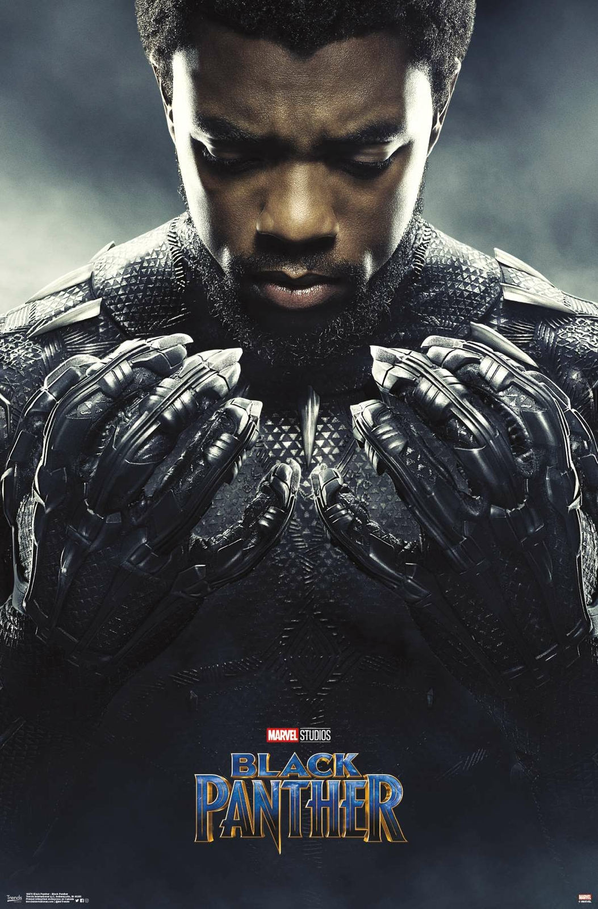

## Terminology (Reminder)

:::: {.incremental}

- **dialect**: A regional or social variety of a language with its own characteristic lexical, phonological, syntactic, and pragmatic properties
- **accent**: Constellations of sounds that, together, point to a regional or social identity (essentially the phonological and phonetic aspect of a dialect)
- **speech community**: A group of people with shared linguistic expectations and norms or shared community membership. See also: communities of practice [@eckert2000language; @eckert2007]
- [from Section 2, Part 6, 10th Oct](https://lin211-fall2026.github.io/slides/lectures/12-Where%20do%20dialects%20come%20from/index.html#/terminology)

::::

## Ling Link

:::::: {.columns}
::: {.column width="25%"}
{.r-stretch}
:::

::: {.column width="75%"}

* We’re going to the movies today\!
  * If a character in a movie or on a TV show has this accent, what kind of character is it most likely?
    - British
    - German
    - Southern US
    - Southeast Asian/Indian
    - NYC Accent
    - Southern California

:::
::::::

# can you hear your own accent?

## Identifying an accent

:::: {.incremental}

- @NeuhauserSimpson2007 asked 22 Native German speakers to identify whether different voices were American English-accented German or French-accented German
- Half of the voices were authentic, non-native German speakers (Americans and French people)
- Half of the voices were *inauthentic* accents imitated by other native German speakers
- Which voices, do **you** expect were more accurately identified as American or French?

::::

## Listeners prefer the imitators

:::: {.incremental}

- The Native German speakers **imitating** American and French accents were more accurately identified as American or French than the actual people from America or France! [@NeuhauserSimpson2007, p. 1807]
- This was true even for the imitations that the native German speakers *knew* were imitations
- An accent doesn't have to sound authentic to be identifiable
- Is this surprising to you?

::::

## Pop culture

* (“popular culture”\) is a set of practices/beliefs that are dominant in society at a certain point in time
  * Transmitted via mass media -- often aimed at younger people
  * Changes over time
  * Can shape world view
  * Exclusionary by definition – cannot include all practices/beliefs
  * Contrast with “high culture”

## Language goes to the movies! {.lens-background}

* Language is a mediator between worlds
* So is the media\!
* We can explore how language is used in relation to movies
  * What was it like when we made the shift from silent films to speaking ones?
  * What is the “transatlantic accent”?
  * Do actors do a good job with accents/dialects?

::: {.notes}

Talk about these as research questions you could ask, see what kind of data they might need

:::

## Accents have two equal parts

::: {.incremental}

1. **Talkers**: people who use a particular set of pronunciation variants (the "constellation of sounds" from earlier)
1. **Listeners**: Just as importantly, hearing an accent requires people who associate that set of pronunciation variants with a particular place, race, class, etc. (just like the constellation analogy!)

:::

:::: {.notes}

a set of pronunciation variants that are stereotypical of the accent, pronunciation variants that mark someone as having that accent (even if it isn't something others might imitate), or pronunciation variants that fly below the radar and might indicate to an accent to a sociolinguist but otherwise go unnoticed.

(just as importantly!) Some awareness on the part of the listener that these pronunciation variants are associated with a specific place, class, race, etc.

::::

## Example: Mancunian

::: {.incremental}

- Today, the accent of Manchester, UK, is one of the more recognizable English accents
- Until the 1990s there was no "Manchester Accent" in the UK
- It doesn't appear in any of the pop culture
- Scholarly works on accent describe it as essentially like other dialects of the region [@wells1982accents; @trudgill1999]
- Considered just "Northern" until the emergence of bands like Joy Division, New Order, The Smiths, The Fall, The Stone Roses, The Happy Mondays, and Oasis

:::

## The Smiths



::: {.notes}

51 seconds, Andy and Mike.  2:15 Johnny

(interviewclips of the smiths,  new order/joy division, and oasis) 

:::

## Oasis



##

::: {.incremental}

- Pronunciation variants existed in Manchester, UK before the 1990s (popular TV show, _Coronation Street_, set in Manchester, began in 1960 )
- If anyone had bothered to measure, the constellation of sounds was all there,
- but without "Manchester", as an idea of a place, and personas like these musicians to attach it to, the *label* didn't really exist
- Now the "Mancunian"/"Manc" accent exists in people's **cultural imagination**, 
- So now people are able to perceive those pronunciation variants together as meaning someplace.

:::

## Everyone has an accent

All speech, everyone's speech, is made up of distinctive pronunciation variants that mark you as being from a place, of a class, holding particular political ideologies, etc.

::: {.incremental}

- Everyone.
- But it is only "an accent" if someone can hear you and say "oh, you're AMERICAN" (if they're foreigners) or "oh, you're SOUTHERN" if they're yankees, or "oh, you're APPALACHIAN" if they're southerners.
- And how specific that perception is depends 

:::

##

## Storytelling

:::::: {.columns}
::: {.column width="40%"}

{width="100%"}
:::

::: {.column width="60%"}

* What makes a good story?
* How do you know?
* Who tells good stories?
* Animated movies
  * Disney is the gold standard\!
  * How do you make inanimate objects seem animate?
:::
::::::

## Stereotypes {background-image=images/silhouettes.png}

::: {.incremental}

* A  __stereotype__ is a cognitive structure that includes the beliefs\, preconceived knowledge\, and expectations about a particular social group held by a particular perceiver
  * It’s about abstract knowledge of what it means to belong to a particular group\, linked to characteristics
  * Widely held and oversimplified
* Where do these things come from?

:::

## Why do we stereotype?

::: {.incremental}

* Cognitively, stereotypes are a natural part of human categorization processes
  * __It’s cognitively efficient: __ Once you have the categories\, you can save on processing time by not reconsidering each “member” of a group
  * __It helps us predict our social world: __ We don’t have to worry because you can easily apply your categories to new individuals
  * __It makes us feel good about ourselves: __ We like our own group \(ingroup\) better than other groups \(outgroups\)
  * __It’s automatic: __ They can even be activated and used without you being aware of it
    * __Subliminal primes __ are stimuli that activate stereotypes without our conscious perception \(subliminal messaging\!\)
:::

## So what do actors do?

To sound like they "have" a particular accent, an actor needs to:

- Understand what the audience believes their character's accent should sound like
- Identify & Practice a key set of features that will evoke that perception
  - Features are phonemes, represented by IPA symbols, Intonation, and ways of holding the jaw
- Every other part of their voice can still be their normal speaking voice

::: {.notes}

play examples of the NYC and Scottish books

:::

## House



## Hugh Laurie



## When it doesn't work

Can you name a movie/TV show and actor in it where you thought the accent was so terrible it was funny or distracted you from what was actually happening\.

## When it doesn't work



## This matters.

:::::: {.columns}
::: {.column width="40%"}

{width="100%"}

:::

::: {.column width="60%"}

* Actors are under increased scrutiny – by native speakers and by people who are very familiar with certain accents – to be as authentic as possible
* Social media\, the internet\, etc\. = a place to discuss = a place to praise/bash
* Even with fictional places!\!
* Whatever it is\, it has to be believable\, it has to be relatable\, and it has to bring in money\!

:::
::::::

---

## What’s next?

* Monday is a continuation of pop culture by asking\, “Do singers have an accent when they sing?”
* Quiz 11 in recitation on Friday
* Be working on Data Analysis \(ask questions\!\)

## References
